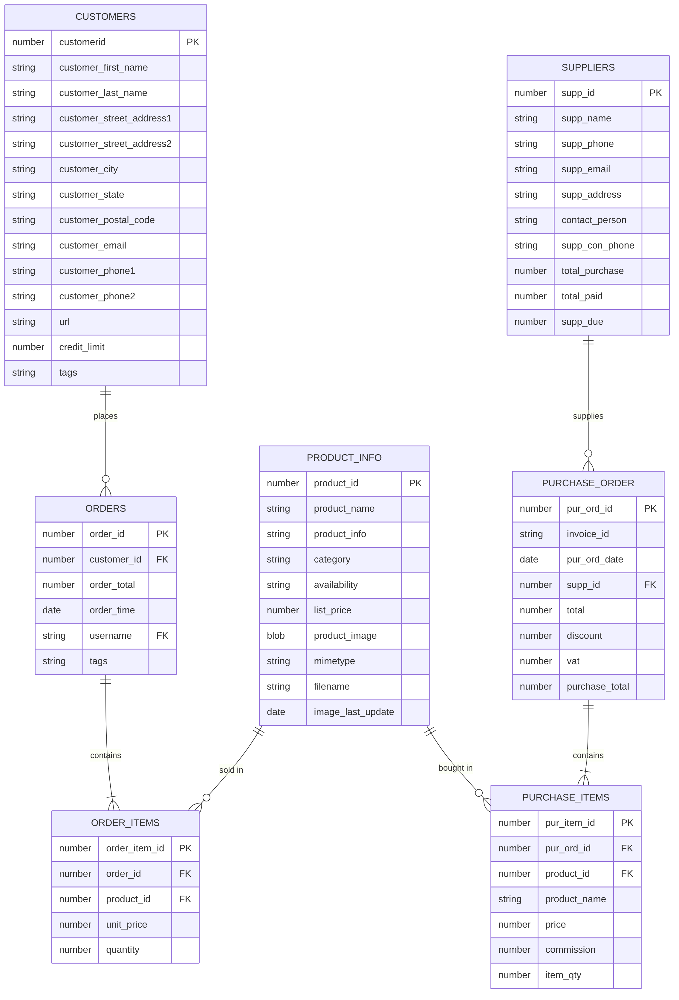
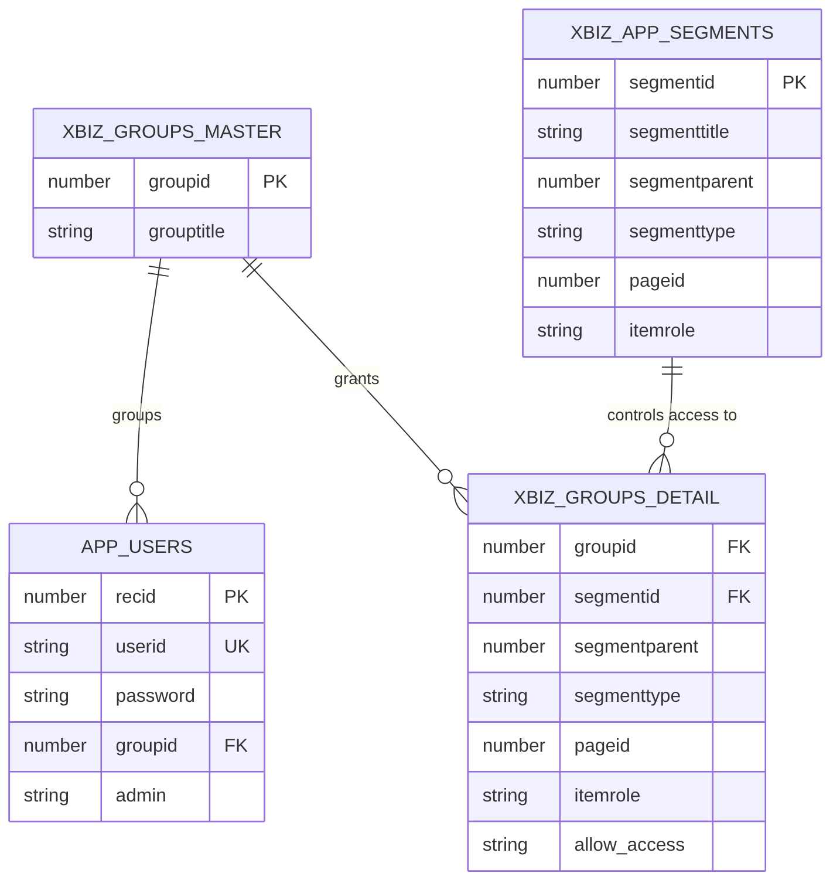

# Inventory Management System

A web-based inventory management app built with **Oracle APEX** (v24.2). Track products, stock, customers, suppliers, orders and purchases from one place.

## Features

- Add, edit and delete products
- Monitor stock levels and update inventory
- Customer, supplier, order and purchase management
- Login system with user groups and per-page authorization
- Dashboard and reports with charts

## Tech stack

- Oracle APEX 24.2 (App Builder)
- Oracle Database (PL/SQL)

## Repository layout

```
apex/f31849.sql   Exported APEX application (ID 31849)
docs/             ER diagrams (PNG + Mermaid source)
```

## Database design (ER diagrams)

**Core business tables** — customers, orders, products, suppliers, purchases:



**Users and access control** — users, groups and the app segments (pages/menu items) each group may access:



Note: `ORDERS.USERNAME` stores the `APP_USERS.USERID` of the staff member who recorded the order (a logical link, left off the diagrams to keep them readable).

The diagrams were reconstructed from the queries and forms in the APEX export, so column types are approximate.

## Setup

1. Create a free workspace at [apex.oracle.com](https://apex.oracle.com) (or use your own APEX instance).
2. Create the database tables the app reads from (see below).
3. In **App Builder**, choose **Import**, select `apex/f31849.sql`, then click **Next** and **Install**.
4. Run the app and sign in with a user you created in `app_users`.

### Database objects

The export contains only the application, not the schema. The app expects these tables (and a `hash_password` function used by the login and reset-password pages):

`app_users`, `customers`, `suppliers`, `product_info`, `orders`, `order_items`, `purchase_order`, `purchase_items`, `xbiz_groups_master`, `xbiz_groups_detail`, `xbiz_app_segments`

> TODO: add `db/schema.sql` with the DDL for these objects (see the maintainer notes).
